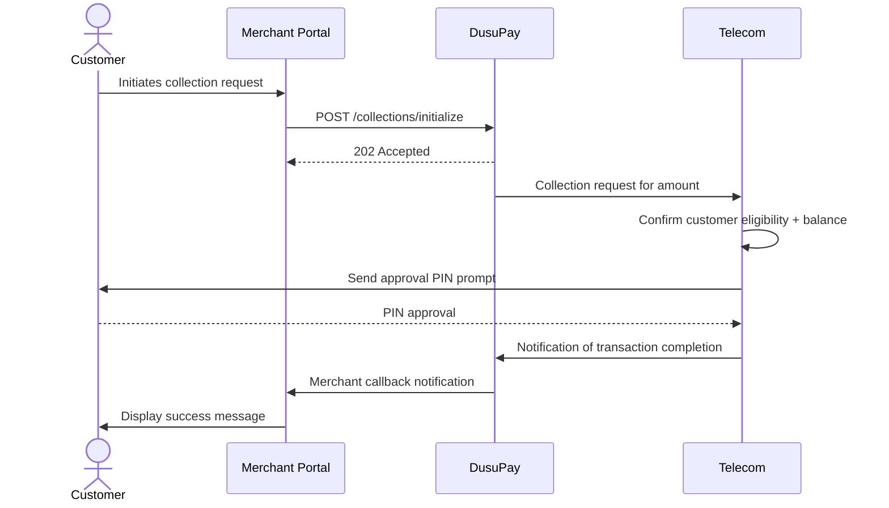

# Mobile Money - Direct Charge

This is one of the ways to process payments using Mobile Money. The section below will guide you through the process of accepting Mobile Money using the direct API method.

## Overview

The currently supported mobile money channels are listed [here](/getting-started/supported-countries-regions.md) (to be updated from time to time). Test mobile money phone numbers are also described in [this](/getting-started/sandbox-test-accounts.md) section. We equally recommend that you go through the [Getting Started](/funds-collection/getting-started.md) section to have a high-level understanding of the funds collection process.

## Workflow Overview

Study this diagram below to understand the customer journey workflow and how the API request/response happens



## Step 1: Obtain the required data for the payment request

The table below describes the request parameters that are used for the collection/charge request. Most/all will be collected from the paying customer.

<table><thead><tr><th width="197">Parameter</th><th width="93">Type</th><th width="98">Required</th><th>Description</th></tr></thead><tbody><tr><td>merchant_reference</td><td>String</td><td>true</td><td>The unique reference for this request. It must be at least 8 characters long. Alternatively, the value <strong>auto</strong> can be passed, and a unique reference will be created for you by the API</td></tr><tr><td>transaction_method</td><td>String</td><td>true</td><td>The transaction method to be used. This will be <em><strong>MOBILE_MONEY</strong></em> for this request</td></tr><tr><td>currency</td><td>String</td><td>true</td><td>The 3-character ISO currency code for the request currency</td></tr><tr><td>amount</td><td>Number</td><td>true</td><td>The amount being requested</td></tr><tr><td>provider_code</td><td>String</td><td>true</td><td>The provider code as obtained from the payment options <a href="/utility-functions/payment-options.md#get-payment-options-list">list</a></td></tr><tr><td>msisdn</td><td>String</td><td>true</td><td>The phone number from which the payment is being requested. This should be sent in international format e.g. 256777000001 for Ugandan numbers</td></tr><tr><td>customer_name</td><td>String</td><td>false</td><td>The name of the customer</td></tr><tr><td>customer_email</td><td>String</td><td>false</td><td>The email of the customer</td></tr><tr><td>description</td><td>String</td><td>true</td><td>The description/narration for the transaction. Between 10-30 characters</td></tr><tr><td>charge_customer</td><td>Boolean</td><td>false</td><td>Whether or not the customer should bear the charge for the transaction. By default, this is <strong>false</strong> to mean that the merchant bears the charge</td></tr><tr><td>allow_final_status_change</td><td>Boolean</td><td>false</td><td>Whether or not the final transaction status can be altered as described <a href="/funds-collection/getting-started.md#transaction-final-status-change">here</a>. By default, this is <strong>true</strong> to mean DusuPay will alter the final transaction status under the circumstances described.</td></tr></tbody></table>

After collecting the necessary mobile money payment information from your customer, prepare your request payload as demonstrated below.

```json
{
  "merchant_reference": "auto",
  "transaction_method": "MOBILE_MONEY",
  "currency": "UGX",
  "amount": 4000,
  "provider_code": "mtn_ug",
  "msisdn": "256777000001",
  "customer_email": "johndoe@gmail.com",
  "customer_name": "JOHN DOE",
  "description": "Test Collection",
  "charge_customer": false,
  "allow_final_status_change": true
}
```

<mark style="color:green;">`POST`</mark> `https://sandboxapi.dusupay.com/collections/initialize`

The request is sent as a JSON body as demonstrated by the sample request below. Sample responses (acknowledgement and failure) are also shared.

```powershell
curl -X POST "https://sandboxapi.dusupay.com/collections/initialize" \
   -H 'Content-Type: application/json' \
   -H "x-api-version: 1" \
   -H "public-key: your-public-key" \
   -d '{
        "merchant_reference": "auto",
        "transaction_method": "MOBILE_MONEY",
        "currency": "UGX",
        "amount": 5000,
        "provider_code": "mtn_ug",
        "msisdn": "256777000001",
        "customer_email": "johndoe@gmail.com",
        "customer_name": "JOHN DOE",
        "description": "Test Collection",
        "charge_customer": false,
        "allow_final_status_change": true
    }'
```




```json
{
  "code": 202,
  "status": "accepted",
  "message": "Request Accepted",
  "data": {
    "internal_reference": "DUSUPAYSTPDKZ6MLY5WPQ",
    "merchant_reference": "MCTREF9WVCPGFRHYCWSK"
  }
}
```





```json
{
  "code": 400,
  "status": "error",
  "message": "256752000001 is not a valid MTN Mobile Money Uganda (mtn_ug) phone number",
  "data": {}
}
```




## Step 2: Handle the payment instructions webhook

If the request in step 1 is successful and responds with an acknowledgement (HTTP code 202), you should listen and handle the payment instructions webhook/callback. This will be sent to the collection callback URL that's configured on your merchant account. The callback is sent as a JSON POST request and the payload will help you determine the next course of action. The tabs below show the two possible payload structures.




```json
{
  "event": "transaction.processing",
  "payload": {
    "id": 27594,
    "merchant_reference": "MCTREF9WVCPGFRHYCWSK",
    "internal_reference": "DUSUPAYSTPDKZ6MLY5WPQ",
    "transaction_type": "COLLECTION",
    "request_currency": "UGX",
    "transaction_amount": 5000,
    "transaction_currency": "UGX",
    "transaction_charge": 150,
    "transaction_account": "256777000001",
    "charge_customer": false,
    "total_credit": 4850,
    "provider_code": "mtn_ug",
    "request_amount": 5000,
    "customer_name": "JOHN DOE",
    "transaction_status": "PROCESSING",
    "status_message": "Transaction Initiated successfully. Approve Payment by entering the PIN",
    "authorization": {
      "mode": "NONE",
      "required_parameters": []
    },
    "payment_instructions": "<p>You will receive a prompt on the mobile number <b>256777000001</b>.<br/> Enter your PIN to authorize your payment of <b>UGX 5,000</b></p>"
  }
}
```





```json
{
  "event": "transaction.processing",
  "payload": {
    "id": 27594,
    "merchant_reference": "MCTREF9WVCPGFRHYCWSK",
    "internal_reference": "DUSUPAYSTPDKZ6MLY5WPQ",
    "transaction_type": "COLLECTION",
    "request_currency": "GHS",
    "transaction_amount": 500,
    "transaction_currency": "GHS",
    "transaction_charge": 150,
    "transaction_account": "233545503456",
    "charge_customer": false,
    "total_credit": 350,
    "provider_code": "mtn_gh",
    "request_amount": 500,
    "customer_name": "JOHN DOE",
    "transaction_status": "PROCESSING",
    "status_message": "Transaction Initiated successfully. OTP sent",
    "authorization": {
      "mode": "OTP",
      "required_parameters": [
        {
          "parameter_name": "otp"
        }
      ]
    },
    "payment_instructions": "<p>Authorize Payment using the OTP sent to <b>233545503456</b>.</p>"
  }
}
```





Pay close attention to the `authorization.mode` parameter. When the value is **NONE**, the merchant should simply display the instructions in the `payment_instructions` parameter. In this scenario, the customer should expect a PIN approval prompt from the telecom. If the mode is **OTP**, it means the OTP has been sent to the phone number and the merchant needs to call another endpoint to submit the OTP and authorize the transaction to proceed as described in step 3 below.


## Step 3: Authorize the transaction (Optional)

If the payment instructions webhook in step 2 above is sent, the transaction status being PROCESSING and the authorization mode is OTP, this means the OTP has been sent to the customer's phone number. The merchant therefore needs to collect the OTP from the customer and submit it in order to verify the phone number and authorize the transaction to proceed.

The parameter `authorization.required_parameters` holds an object array of the parameters the merchant should obtain and submit. In every object, `parameter_name` is the name of the parameter that's going to carry the required value (OTP in this case). Form the payload as demonstrated in the sample request below.


For testing/sandbox purposes, use the OTP **123456** to simulate success and **378961** to simulate failure


<mark style="color:green;">`POST`</mark> `https://sandboxapi.dusupay.com/collections/authorize`

```powershell
curl -X POST "https://sandboxapi.dusupay.com/collections/authorize" \
   -H 'Content-Type: application/json' \
   -H "x-api-version: 1" \
   -H "public-key: your-public-key" \
   -d '{
        "internal_reference": "DUSUPAYSTPDKZ6MLY5WPQ",
        "otp": "123456"
    }'
```

If OTP verification is successful, a PIN prompt will be sent to the mobile money phone number in the request for the customer to approve the transaction. If the customer has sufficient balance for the transaction and is eligible to transact, the request will be successful otherwise the API will send an appropriate error message as shared by the telecom.

## Step 4: Handle the final status webhook

Every merchant account is expected to have configured a callback/webhook URL for collections. For all collections that transition to the final state (COMPLETED, FAILED or CANCELLED), a JSON POST request will be made to the callback URL. Sample callback payloads (request bodies) are shared below. Be sure to check out [Handling Notifications](/utility-functions/handling-notifications-callbacks.md) to see how you should verify the signature(s) in the request headers and how to respond.




```json
{
  "event": "transaction.completed",
  "payload": {
    "id": 20760,
    "merchant_reference": "MCTREFT2WMNWZ23SBN6Y",
    "internal_reference": "DUSUPAYRMGRXNNYBWATKJ",
    "transaction_type": "COLLECTION",
    "request_currency": "UGX",
    "transaction_amount": 2000000,
    "transaction_currency": "UGX",
    "transaction_charge": 60000,
    "transaction_account": "256787008803",
    "charge_customer": false,
    "total_credit": 1940000,
    "provider_code": "mtn_ug",
    "request_amount": 2000000,
    "customer_name": "JOHN DOE",
    "transaction_status": "COMPLETED",
    "status_message": "Transaction Completed Successfully"
  }
}
```





```json
{
  "event": "transaction.failed",
  "payload": {
    "id": 26609,
    "merchant_reference": "MCTREFNRFRTQA6SCWT5X",
    "internal_reference": "DUSUPAYWYUF8CR3ZRCGYU",
    "transaction_type": "COLLECTION",
    "request_currency": "UGX",
    "transaction_amount": 2000000,
    "transaction_currency": "UGX",
    "transaction_charge": 0,
    "transaction_account": "256777000002",
    "charge_customer": false,
    "total_credit": 0,
    "provider_code": "mtn_ug",
    "request_amount": 2000000,
    "customer_name": "JOHN DOE",
    "transaction_status": "FAILED",
    "status_message": "Balance Insufficient for the transaction"
  }
}
```



