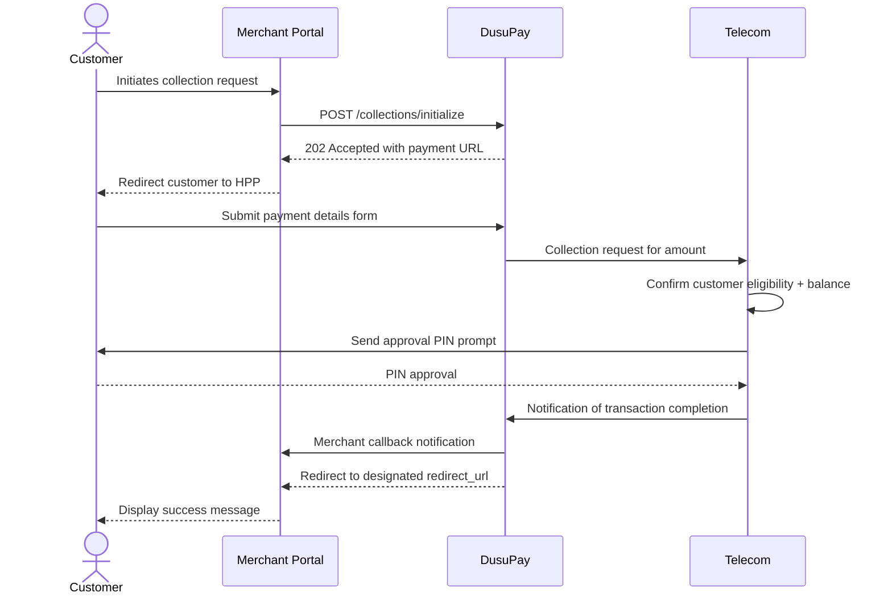

# Mobile Money - Hosted Page

The hosted page workflow is the other way of accepting Mobile Money payments. The merchant initiates a request and in response is given a URL to which the user is redirected to complete the payment

## Overview

The currently supported mobile money channels are listed [here](/getting-started/supported-countries-regions.md) (to be updated from time to time). Test mobile money phone numbers are also described in [this](/getting-started/sandbox-test-accounts.md) section. We equally recommend that you go through the [Getting Started](/funds-collection/getting-started.md) section to have a high-level understanding of the funds collection process.

## Workflow Overview

Study this diagram below to understand the customer journey workflow and how the API request/response happens



## Step 1: Obtain the required data for the payment request

The table below describes the request parameters that are used for the collection/charge request. Most/all will be collected from the paying customer.

<table><thead><tr><th width="197">Parameter</th><th width="93">Type</th><th width="98">Required</th><th>Description</th></tr></thead><tbody><tr><td>merchant_reference</td><td>String</td><td>true</td><td>The unique reference for this request. It must be at least 8 characters long. Alternatively, the value <strong>auto</strong> can be passed, and a unique reference will be created for you by the API</td></tr><tr><td>transaction_method</td><td>String</td><td>true</td><td>The transaction method to be used. This will be <em><strong>MOBILE_MONEY</strong></em> for this request</td></tr><tr><td>currency</td><td>String</td><td>true</td><td>The 3-character ISO currency code for the request currency</td></tr><tr><td>amount</td><td>Number</td><td>true</td><td>The amount being requested</td></tr><tr><td>provider_code</td><td>String</td><td>true</td><td>The provider code as obtained from the payment options <a href="/utility-functions/payment-options.md#get-payment-options-list">list</a></td></tr><tr><td>msisdn</td><td>String</td><td>true</td><td>The phone number from which the payment is being requested. This should be sent in international format e.g. 256777000001 for Ugandan numbers</td></tr><tr><td>customer_name</td><td>String</td><td>false</td><td>The name of the customer</td></tr><tr><td>customer_email</td><td>String</td><td>false</td><td>The email of the customer</td></tr><tr><td>description</td><td>String</td><td>true</td><td>The description/narration for the transaction. Between 10-30 characters</td></tr><tr><td>charge_customer</td><td>Boolean</td><td>false</td><td>Whether or not the customer should bear the charge for the transaction. By default, this is <strong>false</strong> to mean that the merchant bears the charge</td></tr><tr><td>allow_final_status_change</td><td>Boolean</td><td>false</td><td>Whether or not the final transaction status can be altered as described <a href="/funds-collection/getting-started.md#transaction-final-status-change">here</a>. By default, this is <strong>true</strong> to mean DusuPay will alter the final transaction status under the circumstances described.</td></tr><tr><td><mark style="color:orange;">mobile_money_hpp</mark></td><td><mark style="color:orange;">Boolean</mark></td><td><mark style="color:orange;">true</mark></td><td><mark style="color:orange;">Should be sent with the value <strong>true</strong> in order for the API to handle the payment via hosted page</mark></td></tr><tr><td><mark style="color:orange;">redirect_url</mark></td><td><mark style="color:orange;">String</mark></td><td><mark style="color:orange;">true</mark></td><td><mark style="color:orange;">The HTTPs redirect URL to which the API will redirect when the payment is successful/failed</mark></td></tr></tbody></table>

After collecting the necessary mobile money payment information from your customer, prepare your request payload as demonstrated below.

```json
{
  "merchant_reference": "auto",
  "transaction_method": "MOBILE_MONEY",
  "currency": "UGX",
  "amount": 4000,
  "provider_code": "mtn_ug",
  "msisdn": "256777000001",
  "customer_email": "johndoe@gmail.com",
  "customer_name": "JOHN DOE",
  "description": "Test Collection",
  "charge_customer": false,
  "allow_final_status_change": true,
  "mobile_money_hpp": true,
  "redirect_url": "https://your-redirect-url"
}
```

<mark style="color:green;">`POST`</mark> `https://sandboxapi.dusupay.com/collections/initialize`

The request is sent as a JSON body as demonstrated by the sample request below. Sample responses (acknowledgement and failure) are also shared.

```powershell
curl -X POST "https://sandboxapi.dusupay.com/collections/initialize" \
   -H 'Content-Type: application/json' \
   -H "x-api-version: 1" \
   -H "public-key: your-public-key" \
   -d '{
        "merchant_reference": "auto",
        "transaction_method": "MOBILE_MONEY",
        "currency": "UGX",
        "amount": 5000,
        "provider_code": "mtn_ug",
        "msisdn": "256777000001",
        "customer_email": "johndoe@gmail.com",
        "customer_name": "JOHN DOE",
        "description": "Test Collection",
        "charge_customer": false,
        "allow_final_status_change": true,
        "mobile_money_hpp": true,
        "redirect_url": "https://your-redirect-url"
    }'
```




```json
{
  "code": 202,
  "status": "accepted",
  "message": "Request Accepted",
  "data": {
    "internal_reference": "DUSUPAYZAERK2SBE6WJAG",
    "merchant_reference": "MCTREFQSSBHMHU3RCTLA",
    "payment_url": "https://devpay.dusupay.com/pay/collection/DUSUPAYZAERK2SBE6WJAG"
  }
}
```





```json
{
  "code": 400,
  "status": "error",
  "message": "256752000001 is not a valid MTN Mobile Money Uganda (mtn_ug) phone number",
  "data": {}
}
```




## Step 2: Redirect to Payment URL

Notice the `payment_url` parameter in the response body. The URL should be loaded in the browser so that the customer can proceed with the transaction. When the page loads, the customer will be guided through the payment process and on success/failure, the customer will be redirected to the `redirect_url` sent by the merchant in the request. Additionally, a callback/webhook will be sent to the configured collection callback URL.


For testing/sandbox purposes, use the OTP **123456** to simulate success and **378961** to simulate failure. This is in situations where the transaction requires OTP authorization.


## Step 3: Handle the redirect and/or callback

### Redirect

On success/failure of the transaction, the customer will be redirected to the URL that was passed in the `redirect_url` request parameter. The sample requests below demonstrated the success and failure scenarios. You can copy the URL and paste it on [this](https://semalt.tools/en/url-parser) online resource in order to view the query parameters therein.





```powershell
https://webhook.site/cc0393dc-fe49-401b-ba56-da9e099a3648?id=33911&event=transaction.completed&merchant_reference=MCTREFZQTUDRC38TLYUV&internal_reference=DUSUPAYHYJQ3ZUJMPGFG5&transaction_type=COLLECTION&transaction_status=COMPLETED&status_message=Transaction%20Completed%20Successfully&rsa_signature=Y23aNOaOs6NfOnrhpZrWGAOI4bMR5kNobFnrOBlqF%2FY7f03aBpHZx2rcmU3q2P9zS2w61xs3FsT%2FipRI9F21dNJ0UxDQci7yQ%2B7CZbk6kJQbfX9Ht7OIhH2%2F7cv%2FNUXDmXzZQYST3Qwe9QIhea1SIImWRzR8HKAeEeoVRPLDqxohLX4A0S91hjrZVO%2BjohZJLazIeXFrOaJyIu3xPQ7bzJi%2BfVhw6ry3R7NknIj5y752WpW0CqvxXKr3wPUIXy99tnN%2FCWLG65AmVL9GkBZj0j12%2B8ztBpknPBuGKWxndJB7zkkPTCmA%2BA1m21f3RENYTNH7nHet5zp5Iyq%2BkmtVVUmEcfvfAwAxs0sP0fYTFU8iSX6wvB6UEvk3AWgrprlb1XGd3sRgFgCb3HjzA7%2B8RBi%2Fw59qIXqK4LlbOtZw2tPc7MjLeXq%2BmqzrO8SRxyuvu6lX0HPhaHSXAGq%2BvljA1Kk4ZNLdSWxYCC2IgI7%2BPomrfWW1I6pNIF%2BudPTIYTPN6EEdMUwFBltyAoh%2ByHl6K%2F%2Fcz4FfE6OgZwJkbQ8661sHqiB2ND%2FhSQh%2B0Qre1tQTLx7BGQTSGdD34CLn%2FQICIlqNCvKbMF4ZO208xYaBct01T6Xa23zykkrmlTviEMJgSIo3zj2KpN%2BTF1X5jZOXLszBL20o1SeQlY9%2BhRzshzY%3D&hmac_signature=t%3D1721639784089%2Cs%3D1ec4e0f7749397faea80958bca9ab2c6d8e7448c3ee02f958881a392ce299128
```







```powershell
https://mysite.com?id=34639&event=transaction.failed&merchant_reference=MCTREF8DQRHYTNCQTACH&internal_reference=DUSUPAY8A54ZUJFGSMENE&transaction_type=COLLECTION&transaction_status=FAILED&status_message=Balance%20Insufficient%20for%20the%20transaction&rsa_signature=yvODC%2BViCiZmlEEEbQX1B%2FfQ0kNzrYqRN0c3Y8MjzZ%2FiMNVzf%2BUS36Ec8P1a0rOKgyc0l7KVbzEJwMZu0nasAHFuCeSOebs5NOHvSNJkAbQE2nZXgxvo1uQtJOMnbYZZKIvswemRTRGEyAKl7bRGc2AXzYRzJBVOYBVDOM0o36FUpfNNFrucVjvrmJJD8YtRtIXk3RjBzXkhV%2B3KAjWx0KU8bh424OyZUwsRTaN0MeuQMFY%2FkeuFvNKPzxKtN%2BaJqcx4aDZes6thevgfCljgne0ibC9Zy1eDCYP8A1T%2BNTS%2FHUZBuy1Y%2BzAmQ%2BMjnoiI%2FVk2I%2BuoRkHU01%2BMV%2Bo4CFGAoheoQ9N%2B7KFN0f4oAdT3G%2BJZtcwitZ0Q3Jo%2FW3aYNyvrPQHt88hjOtVHKhSNEwUJ8QNfy42WiZJOix4p5I5oyePdYGW5ia09MuaY6BkV8o9mdotcWGpn6O1PsxnxfduI6gbGLWtcxjrat75LeMhGjPLYcJA9CQECK7NvBFHOBUA%2F9rR5gReBVEkdVf5N8q551DvJfR4nENxZukaVMzjhq2IIndOHzRXTyXIxVKGhWAAcGXrVKcXvUvh8Np%2FlJg2bz4xWarvbk%2FFSrXYJj5IwNrOB02N5IzoVCGSyE%2BGWjofyUhgrq%2Ftlralnyp0GpXong2Sl8xB0%2Foucm4xtC60%3D&hmac_signature=t%3D1721967214552%2Cs%3D0a3505923c0541166952726c9c32c9dfdec41d51e4b1016093a6f53f0b9a76e9
```





### Callback/Webhook

Every merchant account is expected to have configured a callback/webhook URL for collections. For all collections that transition to the final state (COMPLETED, FAILED or CANCELLED), a JSON POST request will be made to the callback URL. Sample callback payloads (request bodies) are shared below. Be sure to check out [Handling Notifications](/utility-functions/handling-notifications-callbacks.md) to see how you should verify the signature(s) in the request headers and how to respond.




```json
{
  "event": "transaction.completed",
  "payload": {
    "id": 20760,
    "merchant_reference": "MCTREFT2WMNWZ23SBN6Y",
    "internal_reference": "DUSUPAYRMGRXNNYBWATKJ",
    "transaction_type": "COLLECTION",
    "request_currency": "UGX",
    "transaction_amount": 2000000,
    "transaction_currency": "UGX",
    "transaction_charge": 60000,
    "transaction_account": "256787008803",
    "charge_customer": false,
    "total_credit": 1940000,
    "provider_code": "mtn_ug",
    "request_amount": 2000000,
    "customer_name": "JOHN DOE",
    "transaction_status": "COMPLETED",
    "status_message": "Transaction Completed Successfully"
  }
}
```





```json
{
  "event": "transaction.failed",
  "payload": {
    "id": 26609,
    "merchant_reference": "MCTREFNRFRTQA6SCWT5X",
    "internal_reference": "DUSUPAYWYUF8CR3ZRCGYU",
    "transaction_type": "COLLECTION",
    "request_currency": "UGX",
    "transaction_amount": 2000000,
    "transaction_currency": "UGX",
    "transaction_charge": 0,
    "transaction_account": "256777000002",
    "charge_customer": false,
    "total_credit": 0,
    "provider_code": "mtn_ug",
    "request_amount": 2000000,
    "customer_name": "JOHN DOE",
    "transaction_status": "FAILED",
    "status_message": "Balance Insufficient for the transaction"
  }
}
```





Either of the two (redirect/callback) can be used to confirm the final status of the transaction. We recommend that in either situation, the redirect/callback request is verified (by verifying the signatures)

