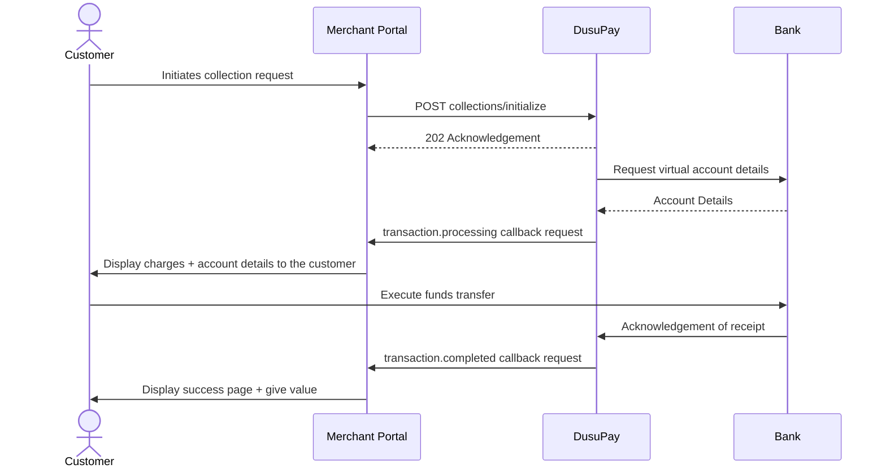

# NGN Bank Transfers - Direct Charge

This is one of the ways to process NGN payments using bank transfers. The section below will guide you through the process of accepting NGN payments using the direct API method.

## Workflow Overview

Study this diagram below to understand the customer journey workflow



1. When your customer is ready to make an NGN payment, you can make the initial collection API request to the gateway, for which an acknowledgement will be done with 202 HTTP response code (you can optionally store the references). Show the customer a loading screen.
2. If there are no issues with the request, the DusuPay platform will proceed to obtain virtual bank details and trigger the [**transaction.processing**](/utility-functions/handling-notifications-callbacks/callback-events.md) event callback/webhook as described in the steps below. Details (charge information + account details) from this payload can be displayed to the customer.
3. As a precaution, listen to the [***request.failed***](/utility-functions/handling-notifications-callbacks/callback-events.md) and [***transaction.failed***](/utility-functions/handling-notifications-callbacks/callback-events.md) event callbacks just in case the request fails before obtaining the bank details. The reason for failure would be part of the callback payload and it's recommended that it's displayed to the customer.
4. If there was no error, the customer can follow the instructions to transfer funds to the account.
5. On success, the bank would notify the DusuPay platform, which would in turn notify you the merchant via your configured callback URL. The customer can be show the success screen.


We recommend that this activity is tracked in your local/platform databases and poll for transaction status from your own data store and update the user interface accordingly. The DusuPay platform automatically retries callbacks if your platform doesn't respond as expected.


## Step 1: Obtain the required data for the payment request

The table below describes the request parameters that are used for the collection/charge request. Most/all will be collected from the paying customer.

<table><thead><tr><th width="219.5238037109375">Parameter</th><th width="93">Type</th><th width="106.485107421875">Required</th><th>Description</th></tr></thead><tbody><tr><td>merchant_reference</td><td>String</td><td>true</td><td>The unique reference for this request. It must be at least 8 characters long. Alternatively, the value <strong>auto</strong> can be passed, and a unique reference will be created for you by the API</td></tr><tr><td>transaction_method</td><td>String</td><td>true</td><td>The transaction method to be used. This will be <em><strong>BANK</strong></em> for this request</td></tr><tr><td>currency</td><td>String</td><td>true</td><td>The 3-character ISO currency code for the request currency</td></tr><tr><td>amount</td><td>Number</td><td>true</td><td>The amount being requested</td></tr><tr><td>provider_code</td><td>String</td><td>true</td><td>The provider code as obtained from the payment options <a href="/utility-functions/payment-options.md#get-payment-options-list">list</a></td></tr><tr><td>customer_name</td><td>String</td><td>false</td><td>The name of the customer</td></tr><tr><td>customer_email</td><td>String</td><td>false</td><td>The email of the customer</td></tr><tr><td>description</td><td>String</td><td>true</td><td>The description/narration for the transaction. Between 10-30 characters</td></tr><tr><td>charge_customer</td><td>Boolean</td><td>false</td><td>Whether or not the customer should bear the charge for the transaction. By default, this is <strong>false</strong> to mean that the merchant bears the charge</td></tr><tr><td>allow_final_status_change</td><td>Boolean</td><td>false</td><td>Whether or not the final transaction status can be altered as described <a href="/funds-collection/getting-started.md#transaction-final-status-change">here</a>. By default, this is <strong>true</strong> to mean DusuPay will alter the final transaction status under the circumstances described.</td></tr></tbody></table>

After collecting the necessary bank payment information from your customer, prepare your request payload as demonstrated below.

```json
{
  "merchant_reference": "auto",
  "transaction_method": "BANK",
  "currency": "NGN",
  "amount": 4000,
  "provider_code": "bank_ng",
  "customer_email": "johndoe@gmail.com",
  "customer_name": "JOHN DOE",
  "description": "Test Collection",
  "charge_customer": false,
  "allow_final_status_change": true
}
```

<mark style="color:green;">`POST`</mark> `https://sandboxapi.dusupay.com/collections/initialize`

The request is sent as a JSON body as demonstrated by the sample request below. Sample responses (acknowledgement and failure) are also shared.

```powershell
curl -X POST "https://sandboxapi.dusupay.com/collections/initialize" \
   -H 'Content-Type: application/json' \
   -H "x-api-version: 1" \
   -H "public-key: your-public-key" \
   -d '{
        "merchant_reference": "auto",
        "transaction_method": "BANK",
        "currency": "NGN",
        "amount": 4000,
        "provider_code": "bank_ng",
        "customer_email": "johndoe@gmail.com",
        "customer_name": "JOHN DOE",
        "description": "Test Collection",
        "charge_customer": false,
        "allow_final_status_change": true
    }'
```




```json
{
  "code": 202,
  "status": "accepted",
  "message": "Request Accepted",
  "data": {
    "internal_reference": "DUSUPAYZAERK2SBE6WJAG",
    "merchant_reference": "MCTREFQSSBHMHU3RCTLA"
  }
}
```





```json
{
  "code": 400,
  "status": "error",
  "message": "Invalid provider code (bank_ug)",
  "data": {}
}
```




## Step 2: Handle the payment instructions webhook

If the request in step 1 is successful and responds with an acknowledgement (HTTP code 202), you should listen and handle the payment instructions webhook/callback. This will be sent to the collection callback URL that's configured on your merchant account. The callback is sent as a JSON POST request and the payload will help you determine the next course of action. Sample payloads below.





```json
{
  "event": "transaction.processing",
  "payload": {
    "id": 14848,
    "merchant_reference": "MCTREFQSSBHMHU3RCTLA",
    "internal_reference": "DUSUPAYZAERK2SBE6WJAG",
    "transaction_type": "COLLECTION",
    "request_currency": "NGN",
    "request_amount": 4000,
    "transaction_currency": "NGN",
    "transaction_amount": 4000,
    "transaction_charge": 80,
    "charge_customer": false,
    "total_credit": 3920,
    "transaction_account": "1771825717058",
    "customer_name": "JOHN DOE",
    "provider_code": "bank_ng",
    "transaction_status": "PROCESSING",
    "status_message": "Transaction Initiated successfully. Deposit funds to the account",
    "payment_instructions": "<p>Please make a payment of <b> NGN 4,000 </b> to the following account.</p><p><table><tr><td>Account number:</td><td></td><td></td><td><b>2121562123</b></td></tr><tr></tr><tr></tr><tr></tr><tr><td>Bank Name:</td><td></td><td></td><td> DUSUPAY</td</tr><tr></tr><tr></tr><tr></tr><tr></tr><tr><td>Beneficiary:</td><td></td><td></td><td> <b> Dusupay Account</b></td></tr><tr></tr></table></p><p><b>Reminder: Use this account only for this transaction, and make sure to complete the payment before the time specified above expires. </b></p>",
    "sub_account_details": {
      "account_name": "DUSUPAY",
      "account_no": "2121562123",
      "bank_name": "WEMA",
      "amount": 4000
    },
    "authorization": {}
  }
}
```







```json
{
  "event": "request.failed",
  "payload": {
    "id": 14848,
    "merchant_reference": "MCTREFQSSBHMHU3RCTLA",
    "internal_reference": "DUSUPAYZAERK2SBE6WJAG",
    "transaction_type": "COLLECTION",
    "request_currency": "NGN",
    "request_amount": 4000,
    "transaction_status": "FAILED",
    "status_message": "Failed to initialize the transaction. System exception!"
  }
}
```







```json
{
  "event": "transaction.failed",
  "payload": {
    "id": 26609,
    "merchant_reference": "MCTREFQSSBHMHU3RCTLA",
    "internal_reference": "DUSUPAYZAERK2SBE6WJAG",
    "transaction_type": "COLLECTION",
    "request_currency": "NGN",
    "request_amount": 4000,
    "transaction_currency": "NGN",
    "transaction_charge": 0,
    "transaction_account": "1771825717058",
    "charge_customer": false,
    "total_debit": 0,
    "provider_code": "bank_ng",
    "transaction_amount": 4000,
    "customer_name": "JOHN DOE",
    "transaction_status": "FAILED",
    "status_message": "Transaction Failed. Billing failure"
  }
}
```





Details from the payload need to be displayed for the customer so they can execute the fund to the transfer. A few things to note;

1. You could directly display the content of the ***payment\_instructions*** parameter OR implement a custom display using content in the ***sub\_account\_details*** object.
2. If the customer is bearing the transaction charge (`charge_customer=true`), we recommend that you display the value in the ***transaction\_charge*** so that the customer is aware of surcharge.

## Step 3: Handle the final status webhook

Every merchant account is expected to have configured a callback/webhook URL for collections. For all collections that transition to the final state (COMPLETED, FAILED or CANCELLED), a JSON POST request will be made to the callback URL. Sample callback payloads (request bodies) are shared below. Be sure to check out [Handling Notifications](/utility-functions/handling-notifications-callbacks.md) to see how you should verify the signature(s) in the request headers and how to respond.




```json
{
  "event": "transaction.completed",
  "payload": {
    "id": 20760,
    "merchant_reference": "MCTREFQSSBHMHU3RCTLA",
    "internal_reference": "DUSUPAYZAERK2SBE6WJAG",
    "transaction_type": "COLLECTION",
    "request_currency": "NGN",
    "transaction_amount": 4000,
    "transaction_currency": "NGN",
    "transaction_charge": 80,
    "transaction_account": "2121562123",
    "charge_customer": false,
    "total_credit": 3920,
    "provider_code": "bank_ng",
    "request_amount": 4000,
    "customer_name": "JOHN DOE",
    "institution_name": "GUARANTY TRUST BANK",
    "transaction_status": "COMPLETED",
    "status_message": "Transaction Completed Successfully"
  }
}
```





```json
{
  "event": "transaction.failed",
  "payload": {
    "id": 26609,
    "merchant_reference": "MCTREFQSSBHMHU3RCTLA",
    "internal_reference": "DUSUPAYZAERK2SBE6WJAG",
    "transaction_type": "COLLECTION",
    "request_currency": "NGN",
    "transaction_amount": 40000,
    "transaction_currency": "NGN",
    "transaction_charge": 0,
    "transaction_account": "2121562456",
    "charge_customer": false,
    "total_credit": 0,
    "provider_code": "mtn_ug",
    "request_amount": 40000,
    "customer_name": "JOHN DOE",
    "transaction_status": "FAILED",
    "status_message": "Request timed out without a transfer"
  }
}
```





We recommend that the webhook/callback requests are verified for authenticity using any of the described signature verification methods.

