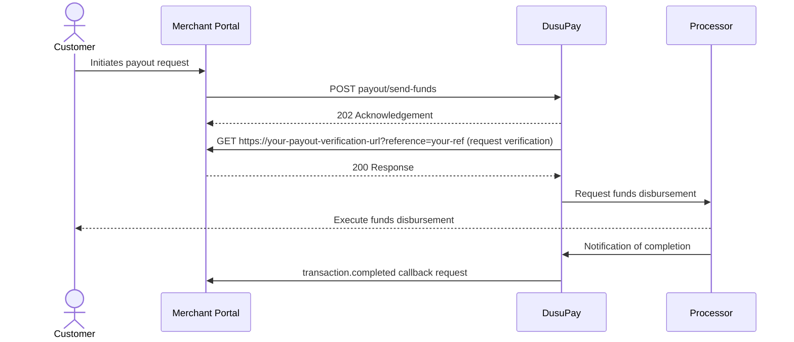

# Getting Started

Payouts, also sometimes called Disbursements, are outbound fund transfers from your merchant account to supported mobile money channels or bank accounts.

The DusuPay API supports funds payout/disbursement via a number of methods e.g. Mobile Money, Bank Transfer and many other methods will be supported along the way. The API enables you to send payments via a simple, secure process that requires only the bank/phone information of the recipients.

The merchant is expected to have configured the **payout notification URL** as well as the **payout verification URL** on the merchant account profile. The notification URL will receive webhook/callback requests when the payout is successful/failed. The verification URL on the other hand allows the DusuPay platform to do a "handshake" with the merchant's platform to verify the authenticity of the request as described in step 2 below.

The payouts/disbursements section will describe the process flows for every available payment method. However, every payout will follow the steps described below, in the order of occurrence.


Before payouts can be initiated, the merchant needs to avail the funds for payout. This can be achieved by requesting transfer of funds collected or deposited prior as described in the [Availing Payout Funds](/appendix/availing-payout-funds.md) section.


The sequence diagram below graphically describes the payout workflow. Detailed documentation thereafter.



### Step 1: The payout API request

The merchant will form the payout request payload (based on the selected payment method) and send it to the API for processing. If there are any errors with the parameters, these would be communicated immediately in the response otherwise the API would respond with an acknowledgement. Take the following the mobile money request and a sample acknowledgement.

```json
{
    "merchant_reference": "MCTREFT2WMNWZ23SBN6Y",
    "transaction_method": "MOBILE_MONEY",
    "currency": "UGX",
    "amount": 1000,
    "provider_code": "mtn_ug",
    "msisdn": "256777000001",
    "customer_name": "JOHN DOE",
    "description": "Test Payout"
}

/*sample acknowledgement would be something like the following*/
{
    "code": 202,
    "status": "accepted",
    "message": "Request Accepted",
    "data": {
        "internal_reference": "DUSUPAYRMGRXNNYBWATKJ",
        "merchant_reference": "MCTREFT2WMNWZ23SBN6Y"
    }
}
```

However, should this process fail in any way even after the acknowledgement e.g. if the merchant is making too many requests to the same phone number, the following failure callback will be sent to the payout callback URL.

```json
{
  "event": "request.failed",
  "payload": {
    "id": 20760,
    "merchant_reference": "MCTREFT2WMNWZ23SBN6Y",
    "internal_reference": "DUSUPAYRMGRXNNYBWATKJ",
    "transaction_type": "PAYOUT",
    "request_currency": "UGX",
    "request_amount": 1000,
    "transaction_status": "FAILED",
    "status_message": "Failed to initialize the transaction. System exception!"
  }
}
```

### Step 2: Payout Request Verification

For every payout request sent to the DusuPay API, a request will be made to the merchant platform via the configured payout verification URL. This is one of the platform's security measures and the purpose of the request is to ensure the merchant platform (database) is "aware" of the transaction. The merchant simply needs to ensure that the configured URL is operational. When a request is sent to it, query your records to confirm that the reference is among your records and in the status/state to be processed. If this is true, respond with a simple HTTP code **200** strictly, which to the API will be translated as permission to process the transaction. Any other response will be regarded "denial" and the API will not move ahead with the processing.

A sample verification request could be like the following. The GET request will have a single query parameter `reference` that holds the value of the merchant reference sent in the payout request prior. The example below assumes that the `merchant_reference` in the request was ***MCTREFDWWJTDYTEAHEQP.***

```powershell
curl -X GET https://your-payout-verification-url?reference=MCTREFDWWJTDYTEAHEQP
```


If the response to that request is HTTP code 200, the API will proceed to queue the transaction for processing and after processing, a notification will be sent to the payout notification URL to communicate the final status of the transaction as described in step 3


### Step 3: Final status notification

This is the notification that communicates the very final status of the transaction, and this would mark the close of the transaction process. Sample completed and failed transaction callbacks/notifications shared below.

```json
/*sample completed transaction callback*/
{
    "event": "transaction.completed",
    "payload": {
        "id": 20760,
        "merchant_reference": "MCTREFT2WMNWZ23SBN6Y",
        "internal_reference": "DUSUPAYRMGRXNNYBWATKJ",
        "transaction_type": "PAYOUT",
        "request_currency": "UGX",
        "transaction_amount": 10000,
        "transaction_currency": "UGX",
        "transaction_charge": 1000,
        "transaction_account": "256787008803",
        "charge_customer": false,
        "total_debit": 11000,
        "provider_code": "mtn_ug",
        "request_amount": 10000,
        "customer_name": "JOHN DOE",
        "transaction_status": "COMPLETED",
        "status_message": "Transaction Completed Successfully"
    }
}

/*sample failed transaction callback*/
{
    "event": "transaction.failed",
    "payload": {
        "id": 26609,
        "merchant_reference": "MCTREFNRFRTQA6SCWT5X",
        "internal_reference": "DUSUPAYWYUF8CR3ZRCGYU",
        "transaction_type": "PAYOUT",
        "request_currency": "UGX",
        "transaction_amount": 10000,
        "transaction_currency": "UGX",
        "transaction_charge": 0,
        "transaction_account": "256777000002",
        "charge_customer": false,
        "total_debit": 0,
        "provider_code": "mtn_ug",
        "request_amount": 10000,
        "customer_name": "JOHN DOE",
        "transaction_status": "FAILED",
        "status_message": "Balance Insufficient for the transaction"
    }
}
```


**Cross-currency Transfers**

If the request currency is different e.g. USD from the payment provider currency (transaction currency) e.g. GHS, the API will convert the USD to GHS and your GHS balance will be debited with the converted amount. More details [here](/appendix/cross-currency-transactions.md).

